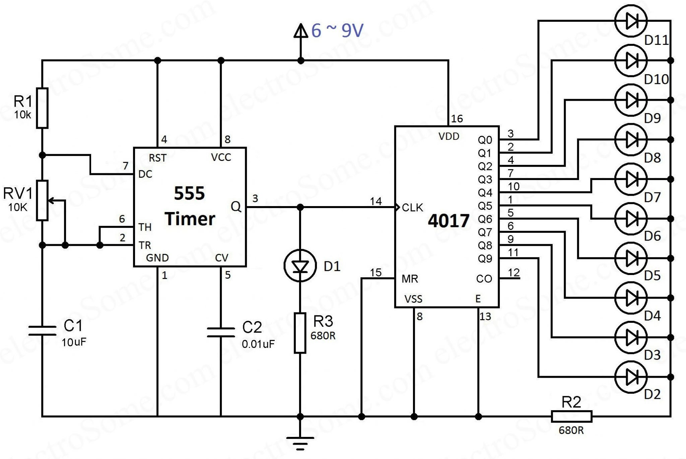

## 第一次作业（HW01）：使用 Proteus 绘制电路原理图

### 1. 作业任务与参考电路

请每位同学独立使用 **Proteus**，根据下面的参考图片重新绘制一遍 **555 定时器与 4017 计数器电路**，完成元件放置、参数设置和导线连接，最后将自己绘制的原理图导出为 PDF。



**本次作业只需提交绘制好的电路原理图 PDF，不需要提交 Proteus 工程文件、PCB 文件、仿真结果、实验报告或压缩包。** 不要求完成仿真或制作实物；工程文件请自行保存在本地，便于修改后重新导出 PDF。

### 2. 绘制要求

- 必须在 Proteus 中自己放置元件、绘制连线，不能直接把参考图片粘贴进 PDF 作为作业。
- 元件数量、参数、电源与接地以及各引脚的连接关系应与参考图一致。
- 元件符号的外观和引脚排列可能与参考图不同，应按引脚编号及功能连接，不要只照着图形位置连线。
- 参考图中的元件标号与参数应清楚可见；检查连接点，避免把导线交叉误画成电气连接，或把应连接的位置画成断线。
- 可以适当调整布局，但应保持电路整洁、导线清楚、文字不重叠。
- 在图纸空白处注明本人姓名、学号和作业编号 `HW01`。

参考图中的主要元件与参数如下，连接关系以图片为准：

| 元件 | 数量 | 型号或参数 |
| --- | --- | --- |
| 555 定时器 | 1 | 555 |
| 4017 计数器 | 1 | 4017 |
| R1 | 1 | 10 kΩ |
| RV1 | 1 | 10 kΩ 可调电阻，注意滑动端连接 |
| R2、R3 | 2 | 各 680 Ω |
| C1 | 1 | 10 μF |
| C2 | 1 | 0.01 μF，即 10 nF |
| D1～D11 | 11 | 按图放置指示灯元件，注意极性 |
| 电源与接地 | 按图 | 电源标注 6～9 V，并绘制公共地 |

### 3. 导出与检查 PDF

绘制完成后先保存本地工程，再生成 PDF。支持直接导出的 Proteus 版本可在原理图的 **Output（输出）** 菜单中查找 PDF 导出选项；也可通过 **File → Printer Setup / Print（打印机设置／打印）** 选择 PDF 打印机输出。具体名称可能随版本和界面语言不同。[Proteus 官方入门教程：原理图 PDF 导出与打印](https://www.labcenter.com/downloads/Tutorials.pdf#page=53)

建议使用 A4 横向页面，调整比例，让整个电路完整呈现在一页中。导出后必须打开 PDF 检查：

- 电路完整，没有元件或导线被裁掉；
- 放大后，元件标号、参数和引脚编号仍然清楚；
- 姓名、学号和 `HW01` 标注正确；
- 文件不是空白页，也不是参考图片或软件界面的截图。

修改电路后，必须重新导出 PDF；只保存 Proteus 工程不会自动更新已导出的 PDF。

### 4. 提交文件、位置和 PR

PDF 文件统一命名为 `学号_HW01.pdf`，存放在 `students/本人学号/HW01/` 中。

例如学号为 `240201101`，本次作业只提交下面这一个文件：

```text
students/240201101/HW01/240201101_HW01.pdf
```

在自己的学号分支上，通过 Pull Request 提交至教师仓库 `rosickey/cad-homework-2026` 的 `main`。标题格式为：

```text
[240201101] HW01 - 王明
```

请替换为自己的学号和姓名。Git 操作见下文 [三、提交电子线路 CAD 作业](https://github.com/rosickey/cad-homework-2026#%E4%B8%89%E6%8F%90%E4%BA%A4%E7%94%B5%E5%AD%90%E7%BA%BF%E8%B7%AF-cad-%E4%BD%9C%E4%B8%9A)

> **首次注册和第一次作业是两个步骤。** 尚未注册的同学，先按下文“二、第一次提交”仅提交 `.student.yml`。等待注册 PR 合并后，再在同一学号分支提交 HW01 的 PDF 并新建作业 PR。已注册的同学无需重复提交或修改身份文件。